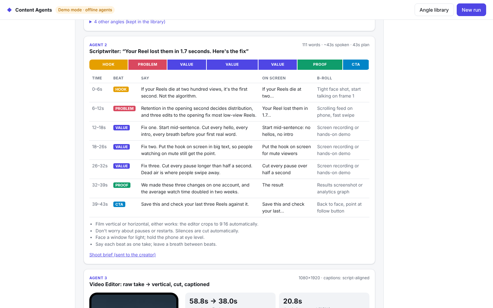

# Content Agents: 5-agent short-form video pipeline (working demo)

A working prototype of a connected, five-agent content system:

| # | Agent | Input → output | How |
|---|---|---|---|
| 1 | **Researcher** | raw topic ideas + trend signals → ranked content angles, saved to a database | Claude (structured output) + Claude web search + Reddit / Google Trends feeds |
| 2 | **Scriptwriter** | chosen angle → 60-second script, shoot brief, "go film" alert | Claude (structured output) + Slack alert |
| 3 | **Video Editor** | raw phone take dropped in a Drive folder → vertical, jump-cut, captioned video | folder watcher + ffmpeg (silence detection, 9:16 crop, burned captions, loudness) |
| 4 | **Copywriter** | finished script → titles, captions and hashtags for Reels, TikTok, Shorts | Claude (structured output) + hard platform-limit checks |
| 5 | **Publisher** | video + copy → drafts on each platform, published only after approval | YouTube Data API, Instagram Graph API, TikTok Content Posting API (dry-run in the demo) |



Sample output from one run: [raw phone take](docs/sample_raw_take.mp4) (59s, 16:9, with pauses) →
[final video](docs/sample_final_vertical.mp4) (38s, 9:16, cut and captioned).

Each stage triggers the next automatically. You step in at three points only:
**pick the angle**, **film the script**, **approve the drafts**.

```
 topics ─► [1 Researcher] ─► ◆ you pick angle ─► [2 Scriptwriter] ─► ◆ you film
                                                                        │ (phone → Drive folder)
        ◆ you approve ◄─ [5 Publisher] ◄─ [4 Copywriter] ◄─ [3 Video Editor] ◄┘
```

## Run it

Needs Python 3.10+ and ffmpeg (`brew install ffmpeg`). Slim ffmpeg builds (like Homebrew's)
are fine: captions fall back to Pillow and the simulated take uses macOS `say` for the voice.

```bash
cd content-agents-demo
pip install -r requirements.txt
python -m content_agents serve        # → http://127.0.0.1:8765
```

Without an `ANTHROPIC_API_KEY` it runs in **demo mode**: the three writing agents return
prepared outputs so the whole flow works offline. The video editor, the Drive-folder watcher,
the database, platform-limit checks and draft queueing are real in both modes.
Set `ANTHROPIC_API_KEY` (see `.env.example`) and every agent runs on Claude.

Terminal-only run (auto-approves both checkpoints, simulates the filming step):

```bash
python -m content_agents run --auto "AI tools for small business marketing"
python -m content_agents run --auto --footage ~/Movies/my_take.mov "my topic"   # use a real clip
```

Tests: `pip install -r requirements-dev.txt && python -m pytest -q`

## Demo walkthrough (about 5 minutes)

1. **New run**: paste 2–3 raw topic ideas → *Start agents*.
2. **Researcher** shows the trend signals it used and 3–5 ranked angles (hook, key points, why now).
   All angles go into the angle library (*Angle library* button). Click **Produce this angle**.
3. **Scriptwriter** writes the 60-second script: beat timeline, what to say, on-screen text,
   b-roll, filming tips. It sends the "go film" alert and writes a shoot brief.
4. Click **Simulate phone upload**. This generates a raw 16:9 take of the script with real pauses
   (text-to-speech) and drops it in the watched folder, the same way a phone upload to Drive would.
   Or click **Upload a real clip** and use any phone video.
5. **Video editor** picks it up on its own: cuts the dead air, crops to 1080×1920, burns in
   short-form captions plus a hook banner for the first 3 seconds, and normalizes audio to −14 LUFS.
   Play the result in the phone frame; open *Raw take* to compare.
6. **Copywriter** writes per-platform copy, with character counts against each platform's limits.
7. **Publisher** queues three drafts. Expand *API calls* to see the exact requests per platform.
   Untick any platform, then **Approve & publish selected**.

## How it's built

```
content_agents/
  agents/researcher.py     Agent 1   trend signals → angles (DB)
  agents/scriptwriter.py   Agent 2   angle → script + shoot brief + alert
  agents/video_editor.py   Agent 3   raw clip → final vertical video
  agents/copywriter.py     Agent 4   script → platform copy + limit enforcement
  agents/publisher.py      Agent 5   drafts per platform, publish on approval
  pipeline.py              orchestrator: state machine, checkpoints, Drive-folder watcher
  media.py                 ffmpeg: silencedetect → cut list → crop → ASS captions → render
  llm.py                   Claude client (structured outputs, web search, refusal fallback)
  demo_llm.py              offline stand-in with the same interface
  trends.py                Reddit / Google Trends feeds (fail-soft, sample feed fallback)
  store.py                 SQLite: runs, activity log, content-angle library
  server.py, static/       dashboard + JSON API (standard library only)
```

- **Typed hand-offs.** Each agent returns a Pydantic model (`ContentAngle`, `VideoScript`,
  `EditResult`, `CopyPack`, `DraftRecord`). Claude's structured outputs guarantee valid JSON,
  so agents never parse free text, and any one agent can be re-run or swapped on its own.
- **State is saved after every stage** (SQLite). A crash or restart resumes where it stopped;
  a failed stage can be retried from the dashboard without redoing earlier ones.
- **Model:** `claude-opus-5-5` by default (`CA_MODEL` to change), with Anthropic's server-side
  fallback enabled so a declined request is retried rather than stalling the pipeline.
- **Captions:** aligned to the script's sentences using the detected speech runs. Install
  `faster-whisper` and the editor switches to word-level timestamps from the audio, which
  is better when the creator ad-libs.

### What each platform's "draft" is

| Platform | Draft | On approval |
|---|---|---|
| YouTube Shorts | uploaded as a **Private** video | set to Public |
| Instagram Reels | Reels **media container** created, not published | `media_publish` |
| TikTok | uploaded to the creator's **TikTok inbox** (drafts) | finish posting in the TikTok app |

The demo records these requests (dry-run) instead of sending them. Going live needs each
platform's developer app and OAuth tokens for the client's accounts. Instagram also needs the
final video at a public URL (e.g. S3/R2), and TikTok's API needs app review for posting scopes.

## From demo to production

1. **Accounts & credentials:** Claude API key; Google Drive folder; YouTube, Meta (Instagram
   business account) and TikTok developer apps with OAuth; Slack webhook.
2. **Drive:** Drive for Desktop sync works as-is (`CA_INBOX_DIR`). For a cloud deployment, swap
   the folder watcher for Drive API change notifications.
3. **Publishing:** turn the dry-run request specs into live calls per platform, plus token refresh
   and retry handling.
4. **Brand voice:** add the client's past top posts and tone guide to the agents' prompts.
5. **Hosting:** run the service on a small VM or container with a queue (the stage functions
   already run independently), and add auth to the dashboard.
6. **Add-on agents** that fit the same pattern: analytics (pull post performance back into the
   angle library so the researcher learns what works), repurposing, engagement.
